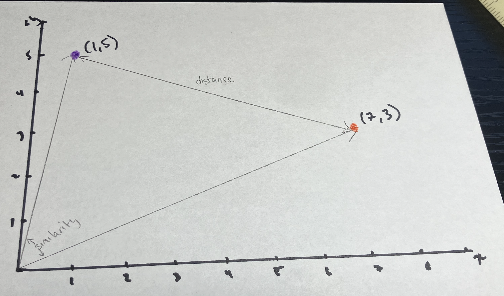

## From interpreting to comparing

- To this point, we've worked with individual mass spectra (as a representative measurement)
    - we looked at loading the measurement
    - plotting it
    - processing it (e.g., removing peaks)
    - interpreting it (e.g., identifying the base peak, identifying significant peaks)<br><br>
    
- In addition to looking at individual measurements, we often want to compare measurements

<script>
document.addEventListener("DOMContentLoaded", function() {
  const button = document.createElement("button");

  button.innerHTML = "☾";
  button.title = "Toggle night mode";

  button.style.position = "fixed";
  button.style.top = "15px";
  button.style.right = "15px";
  button.style.zIndex = "1000";
  button.style.fontSize = "1.2em";
  button.style.padding = "5px 10px";

  button.onclick = function() {
    document.querySelector(".reveal").classList.toggle("night-mode");
  };

  document.body.appendChild(button);
});
</script>


## Comparing two mass spectra

- Load and plot two mass spectra

::: {.fragment}

```{r}

SpecA = read.table("U1.txt")
mzA = SpecA[,1]
intA = SpecA[,2]/max(SpecA[,2])

SpecB = read.table("U2.txt")
mzB = SpecB[,1]
intB = SpecB[,2]/max(SpecB[,2])
```

```{r}
#| eval: false
plot(mzA,
     intA,
     type="h",
     xlab="mass-to-charge ratio",
     ylab="relative intensity") 

plot(mzB,
     intB,
     type="h",
     xlab="mass-to-charge ratio",
     ylab="relative intensity") 
```
:::

## Comparing two mass spectra

- In MS, it is common to create *head-to-tail* plots to compare and contrast mass spectra 

::: {.fragment}

```{r}
#| eval: false
minx = min(mzA,mzB)
maxx = max(mzA,mzB)

plot(mzA,
     intA,
     type="h",
     xlab="mass-to-charge ratio",
     ylab="relative intensity",
     xlim=c(minx,maxx),
     ylim=c(-1,1),
     col="purple") 

matplot(mzB,
        -intB,
        type="h",
        col="blue",
        add=TRUE) 
```
:::

## Comparing two mass spectra

- When we compare and contrast data, we are really looking for similarities and differences
  - number of common peaks?
  - number of common major peaks?
  - fraction of common major peaks compared to all peaks?
  - fraction of total relative intensity accounted for by common peaks?<br><br>
  
- **IMPORTANT:** We need to explicitly define metrics of similarity (or differences) to support rigorous comparison and transparent communications

## On vectors

- Vectors are mathematical objects that can be thought of as *points* in higher dimensional space
  - E.g., used in chemistry and physics to describe objects with multiple properties (e.g., magnitude and direction)<br><br>

- From geometry, we have some standard methods for comparing vectors <br><br>

- Consider the 2D vectors (1,5) and (7,3)

## Comparing vectors  


## Comparing vectors

- *Distance*
  - How far are the vectors in n-dimensional space
  - **Euclidean Distance: ** $d(x,y) = \sqrt{\sum_i^n(x_i-y_i)^2}$<br><br>


- *Similarity*
  - A function of the angle between the vectors in n-dimensional space
  - **Cosine Similarity: ** $s(x,y) = \frac{\sum_i^n x_iy_i}{\sqrt{\sum_i^n x_i^2}\sqrt{\sum_i^n y_i^2}}$


## Comparing vectors

```{r}
#| eval: false

A = c(1,5)
B = c(7,3)

ED = sqrt(sum((A-B)^2))
CS = sum(A*B)/(sqrt(sum(A*A))*sqrt(sum(B*B)))
cat(paste0("The euclidean distance between vectors A and B is ",round(ED,3),"\n"))
cat(paste0("The cosine similarity between vectors A and B is ",round(CS,3),"\n"))
```
```{r}
#| eval: false 

A = c(1,5,5,7,6,8)
B = c(7,3,2,8,9,1)

ED = sqrt(sum((A-B)^2))
CS = sum(A*B)/(sqrt(sum(A*A))*sqrt(sum(B*B)))
cat(paste0("The euclidean distance between vectors A and B is ",round(ED,3),"\n"))
cat(paste0("The cosine similarity between vectors A and B is ",round(CS,3),"\n"))
```
```{r}
#| eval: false
A = c(1,5,0,0)
B = c(7,3,0,0)

ED = sqrt(sum((A-B)^2))
CS = sum(A*B)/(sqrt(sum(A*A))*sqrt(sum(B*B)))
cat(paste0("The euclidean distance between vectors A and B is ",round(ED,3),"\n"))
cat(paste0("The cosine similarity between vectors A and B is ",round(CS,3),"\n"))
```

## From mass spectra to vectors
- If we can represent our mass spectral measurements as **comparable** vectors, we can use the idea of distances and similarities as an objective way to compare mass spectra<br><br>
  - a standard approach with low-resolution (integer resolution) mass spectra is to create vectors that are the length of the highest *m/z* value and populate the vector such that the value at each index of the vector is the intensity from the corresponding *m/z* in the spectrum

## From mass spectra to vectors
```{r}
#| eval: true

SpecA = read.table("U1.txt")
mzA = SpecA[,1]
intA = SpecA[,2]/max(SpecA[,2])

A = numeric(max(mzA)) # create a numeric vector the length of the highest mass to charge ratio in A filled with zeros
A[129:136]

for(i in 1:length(mzA)){
  A[mzA[i]] = intA[i]
}
A[129:136]
```

## From mass spectra to vectors
- **IMPORTANT:** When comparing two vectors, they must be of the same dimension
  - If two mass spectra have different highest mass-to-charge ratios; we make sure the vectors created by these mass spectra take the length of the higher of the two mass-to-charge ratios
  
## From mass spectra to vectors
```{r}
#| eval: true

SpecA = read.table("U1.txt")
mzA = SpecA[,1]
intA = SpecA[,2]/max(SpecA[,2])

SpecB = read.table("U2.txt")
mzB = SpecB[,1]
intB = SpecB[,2]/max(SpecB[,2])

maxMz = max(c(mzA,mzB))
A = numeric(maxMz)
B = numeric(maxMz)

for(i in 1:length(mzA)){
  A[mzA[i]] = intA[i]
}

for(i in 1:length(mzB)){
  B[mzB[i]] = intB[i]
}

ED = sqrt(sum((A-B)^2))
CS = sum(A*B)/(sqrt(sum(A*A))*sqrt(sum(B*B)))
cat(paste0("The euclidean distance between vectors A and B is ",round(ED,3),"\n"))
cat(paste0("The cosine similarity between vectors A and B is ",round(CS,3),"\n"))

```  

## From mass spectra to vectors

- We can be selective (and more efficient) when constructing a vector embedding of a mass spectrum
    - [Domain-segmented similarity score](https://chemrxiv.org/doi/abs/10.26434/chemrxiv.15007342/v2){target="_blank"}: This is a new article I wrote where we are trying to use contextual knowledge when comparing high resolution mass spectra<br><br>
- We can also experiment with other measures of similarity and distances
    - [Pattern similarity measures](https://tsapps.nist.gov/publication/get_pdf.cfm?pub_id=929428){target="_blank"}: This is an old article I wrote where we compare several standard measures of similarity used in pattern recognition to more "customized" measures found in the mass spectrometry literature
  

## Coming up
- Seminars are running in-person on Thursday November 5th<br> 
  - 5-7 PM (SC 204) and 8-10 PM (SC W1)<br><br>
- **Next week:** Projections and dimensionality reduction
  - Looking at a set of more than 2 measurements
  