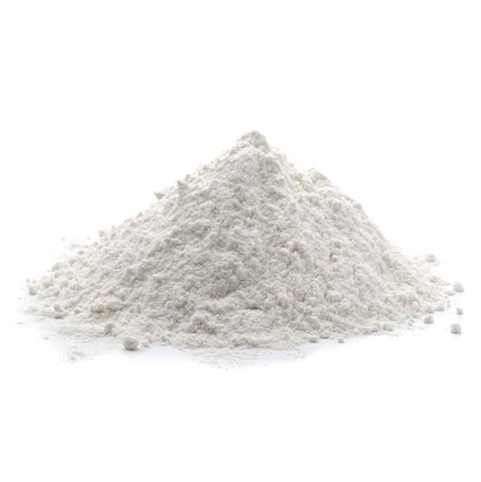
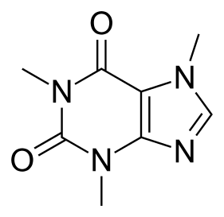
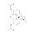
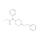
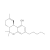
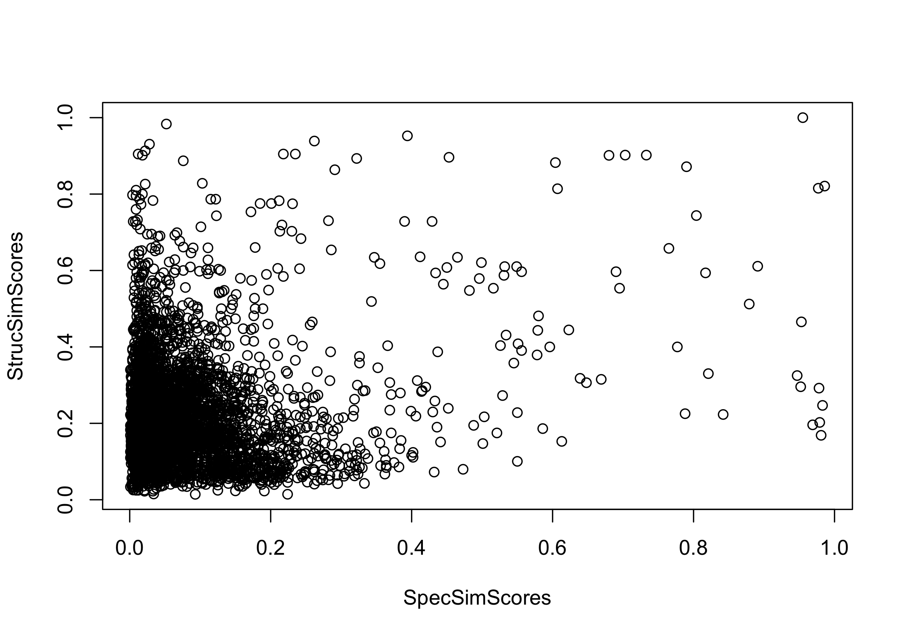

## Recap

- You've looked at measurements.
- You've implemented some code to process a measurement (create a vector representation)
- You've looked at pairs of measurements.
- You've implemented code to compare measurements (compute vector similarity and distance)
- You've looked at collections of measurements.
- You've conducted a library search, and we've discussed clustering and dimensionality reduction techniques that can be used with collections of vectors


## What is a sample? 

:::: {.columns}

::: {.column width="60%"}
<br>
A **sample** is a physical material we are trying to identify (or classify or safely dispose of or otherwise deal with)

- [Usually a subset of a larger population]{style="font-size:85%"}
- [Insights from the sample may allow us to infer something about the population]{style="font-size:85%"}
    

:::

::: {.column width="40%"}
{fig-align="center"}
:::


::::

<script>
document.addEventListener("DOMContentLoaded", function() {
  const button = document.createElement("button");

  button.innerHTML = "☾";
  button.title = "Toggle night mode";

  button.style.position = "fixed";
  button.style.top = "15px";
  button.style.right = "15px";
  button.style.zIndex = "1000";
  button.style.fontSize = "1.2em";
  button.style.padding = "5px 10px";

  button.onclick = function() {
    document.querySelector(".reveal").classList.toggle("night-mode");
  };

  document.body.appendChild(button);
});
</script>


## What is a structure?

:::: {.columns}

::: {.column width="60%"}
<br>
A **structure** is a human-defined representation of the relationship between the atoms that constitute a compound

- [Names [**common** vs IUPAC]]{style="font-size:65%"}
- [Encodings [**SMILES** vs InChI vs InChIKey]]{style="font-size:65%"}   
- [Diagrams [Line drawings]]{style="font-size:65%"}   


[How materials are described; How materials are scheduled]{.fragment}
:::

::: {.column width="40%"}
{fig-align="center"}
:::


::::

``` {r setup}
#| include: false
library(rcdk)

asm_Mol2SVG <- function(mol,
                       width = 500,
                       height = 500,
                       margin = 5,
                       zoom=2) {
  
  # Generate 2D coordinates
  generate.2d.coordinates(mol)
  
  # Create CDK depiction generator
  dg_class <- J("org.openscience.cdk.depict.DepictionGenerator")
  dg <- new(dg_class)
  
  # Set size
  dg <- dg$withSize(width, height)$withMargin(margin)$withZoom(zoom)
  
  # Generate depiction
  depiction <- dg$depict(mol)
  
  # Return SVG XML
  depiction$toSvgStr()
}


smiles1 <- "CC(=O)O[C@H]1C=C[C@H]2[C@H]3CC4=C5[C@]2([C@H]1OC5=C(C=C4)OC(=O)C)CCN3C"
smiles2 <- "CCC(=O)N(C1CCN(CC1)CCC2=CC=CC=C2)C3=CC=CC=C3"
smiles3 <- "CCCCCC1=CC(=C2[C@@H]3C=C(CC[C@H]3C(OC2=C1)(C)C)C)O"
mol1 <- parse.smiles(smiles1)[[1]]
mol2 <- parse.smiles(smiles2)[[1]]
mol3 <- parse.smiles(smiles3)[[1]]

writeLines(asm_Mol2SVG(mol1,width=50,height=50,zoom=10),"../figures/heroin.svg")
writeLines(asm_Mol2SVG(mol2,width=50,height=50,zoom=10),"../figures/fentanyl.svg")
writeLines(asm_Mol2SVG(mol3,width=50,height=50,zoom=10),"../figures/d9-thc.svg")

```

## Are these three structures similar?

:::: {.columns}

::: {.column width="33%"}
{width=100%}
:::

::: {.column width="33%"}
{width=100%}
:::

::: {.column width="33%"}
{width=100%}
:::

::::

## How can we objectively compare structures?

- If we create vector representations of information contained in the structure, we can use the same math tools we used with vectors of measurements!<br><br>

  - $\mathrm{Heroin}\rightarrow\mathrm{C}_{21}\mathrm{H}_{23}\mathrm{N}\mathrm{O}_{5} \rightarrow [21,23,1,5]$ 
  
  - $\mathrm{Fentanyl}\rightarrow \mathrm{C}_{22}\mathrm{H}_{26}\mathrm{N}_{2}\mathrm{O} \rightarrow [n_C,n_H,n_N,n_O]$
  
  - $\Delta 9 \mathrm{THC}\rightarrow\mathrm{C}_{21}\mathrm{H}_{30}\mathrm{O}_{2} \rightarrow [n_C,n_H,n_N,n_O]$<br><br>
  
- *Molecular fingerprints* are vector encodings that account for various structural (and other) information that can be pulled form a compound


## Working with chemical structures

- the ```rcdk``` package is an R interface to a very popular cheminformatics library (Chemistry Development Kit)
  - ```rdkit``` is a python interface to the same library

::: {.fragment}
```{r}
if("rcdk" %in% installed.packages()==FALSE) install.packages("rcdk")
library(rcdk)

Library = readRDS("asm_ReferenceMSLibrary_SWDRUG314.RDS") # loads the reference library

heroin = 1836 # these are the index values in our RDS library
fentanyl = 1906 # these are the index values in our RDS library
d9THC = 3284 # these are the index values in our RDS library

```
:::

## Extracting the SMILES from the library

- Step 1: We want to pull the [SMILES](https://en.wikipedia.org/wiki/Simplified_Molecular_Input_Line_Entry_System){target="_blank"} for the compounds

::: {.fragment}
```{r}

heroin_SMILES_messedUp = Library$IndexData$SMILES[heroin]
heroin_SMILES = strsplit(heroin_SMILES_messedUp,"\t")[[1]][1]

heroin_mol = parse.smiles(heroin_SMILES)[[1]] # function from rcdk package
# view.molecule.2d(heroin_mol) # function from the rcdk package
```
:::

- We'll streamline the process for the other two compounds

::: {.fragment}
```{r}
fentanyl_SMILES = strsplit(Library$IndexData$SMILES[fentanyl],"\t")[[1]][1]
fentanyl_mol = parse.smiles(fentanyl_SMILES)[[1]]

d9THC_SMILES = strsplit(Library$IndexData$SMILES[d9THC],"\t")[[1]][1]
d9THC_mol = parse.smiles(d9THC_SMILES)[[1]]
```
:::

## Converting SMILES to fingerprint

- Step 2. We want to convert the SMILES to a molecular fingerprint

::: {.fragment}
```{r}
heroin_fp = get.fingerprint(heroin_mol,type="standard") # function from the rcdk package
fentanyl_fp = get.fingerprint(fentanyl_mol,type="standard")
d9THC_fp = get.fingerprint(d9THC_mol,type="standard")
```
:::

- Step 3. "Extract" the vector from the molecular fingerprint information

::: {.fragment}
```{r}
heroin_x = numeric(heroin_fp@nbit)
heroin_x[heroin_fp@bits] = 1

fentanyl_x = numeric(fentanyl_fp@nbit)
fentanyl_x[fentanyl_fp@bits] = 1

d9THC_x = numeric(d9THC_fp@nbit)
d9THC_x[d9THC_fp@bits] = 1
```
:::

## Numerical comparison of molecular fingerprints

- We can use the same machinery that we developed for comparing mass spectra to compare fingerprints 

::: {.fragment}
```{r}
source("CustomFunctions/LibrarySearchFunctions.R")
cat(paste0("Similarity between heroin and fentanyl: ", euclideanDistance(heroin_x,fentanyl_x),"\n"))
cat(paste0("Similarity between heroin and d9-THC: ",euclideanDistance(heroin_x,d9THC_x),"\n"))
cat(paste0("Similarity between d9THC and fentanyl: ",euclideanDistance(d9THC_x,fentanyl_x),"\n"))
```
:::

- **NOTE:** most people wouldn't use a euclidean distance to compare "barcode" data like fingerprints, they would use a *Tanimoto index* or other measure of overlap


## Visual comparison of molecular fingerprints

- We can use the same machinery that we developed for comparing mass spectra to compare fingerprints with some minor modifications

::: {.fragment}
```{r}
#| eval: false

HT_plot(seq(heroin_fp@nbit),heroin_x,seq(fentanyl_fp@nbit),fentanyl_x)
HT_plot(seq(heroin_fp@nbit),heroin_x,seq(d9THC_fp@nbit),d9THC_x)
HT_plot(seq(d9THC_fp@nbit),d9THC_x,seq(fentanyl_fp@nbit),fentanyl_x)
```
:::

## Key Points

- Chemometrics/informatics are very similar
- The first step is the hardest: coming up with a reasonable way to represent the information as a vector
  - some articles call this encoding, embedding, feature selection
  - most articles do not explain how they do this
- The second step is implementing numerical algorithms to work with vectors
  - not as hard anymore with open source packages
- Decisions at each step will affect results and interpretations, important to be explicit about design choices 


## Chemical Space!

- Let's create plots representing "chemical space" by looking at the structural and spectral similarity of all unique combinations of a set of compounds

::: {.fragment}
```{r}
#| eval: false

rm(list=ls())
source("CustomFunctions/LibrarySearchFunctions.R")
Library = readRDS("asm_ReferenceMSLibrary_SWDRUG314.RDS")
if("rcdk" %in% installed.packages()==FALSE) install.packages("rcdk")
library(rcdk)

nCompounds = 50
COI = sample(seq(1,dim(Library$IndexData)[1]),nCompounds) # selecting a random set of compounds of interest (COI)

nComputes = (nCompounds^2-nCompounds)/2
SpecSimScores = numeric(nComputes)
StrucSimScores = numeric(nComputes)
labels = character(nComputes)

counter = 0
stime <- system.time({
for(i in 1:nCompounds){
    
    SMILES_i = strsplit(Library$IndexData$SMILES[COI[i]],"\t")[[1]][1]
    mol_i = parse.smiles(SMILES_i)[[1]]
    fp_i = get.fingerprint(mol_i,type="standard")@bits # pulling the bits directly
    
    indices_i = which(Library$SpectralData$SpecID==COI[i])
    spec_mz_i = Library$SpectralData$mz[indices_i]
    spec_int = Library$SpectralData$int[indices_i]
    spec_int_i = spec_int/max(spec_int)
    
  for(j in 1:nCompounds){
    if(i >= j) next
  
      SMILES_j = strsplit(Library$IndexData$SMILES[COI[j]],"\t")[[1]][1]
      mol_j = parse.smiles(SMILES_j)[[1]]
      fp_j = get.fingerprint(mol_j,type="standard")@bits
      
      indices_j = which(Library$SpectralData$SpecID==COI[j])
      spec_mz_j = Library$SpectralData$mz[indices_j]
      spec_int = Library$SpectralData$int[indices_j]
      spec_int_j = spec_int/max(spec_int)
    
      maxmz = max(spec_mz_i,spec_mz_j)
      A = spec2vec(spec_mz_i,spec_int_i,maxmz)
      B = spec2vec(spec_mz_j,spec_int_j,maxmz)
    
      counter = counter + 1
      SpecSimScores[counter] = cosineSim(A,B)
      StrucSimScores[counter] = length(intersect(fp_i,fp_j))/length(union(fp_i,fp_j)) # this is a Tanimoto similarity coefficient
      labels[counter] = paste0(Library$IndexData$Name[COI[i]],"\n vs. \n", Library$IndexData$Name[COI[j]])
    
  }
}
})[3]

cat(paste0("This computation took ",round(stime,3)," seconds.\n"))
plot(SpecSimScores,StrucSimScores)
text(SpecSimScores,StrucSimScores,labels,cex=0.5)
```

::: 


##

{width=100% fig-align="center"}


## Coming up
- Seminars are running in-person on Thursday November 26th<br> 
  - 5-7 PM (SC 204) and 8-10 PM (SC W1)<br><br>
- **Next week:** Special Lecture with Kristen